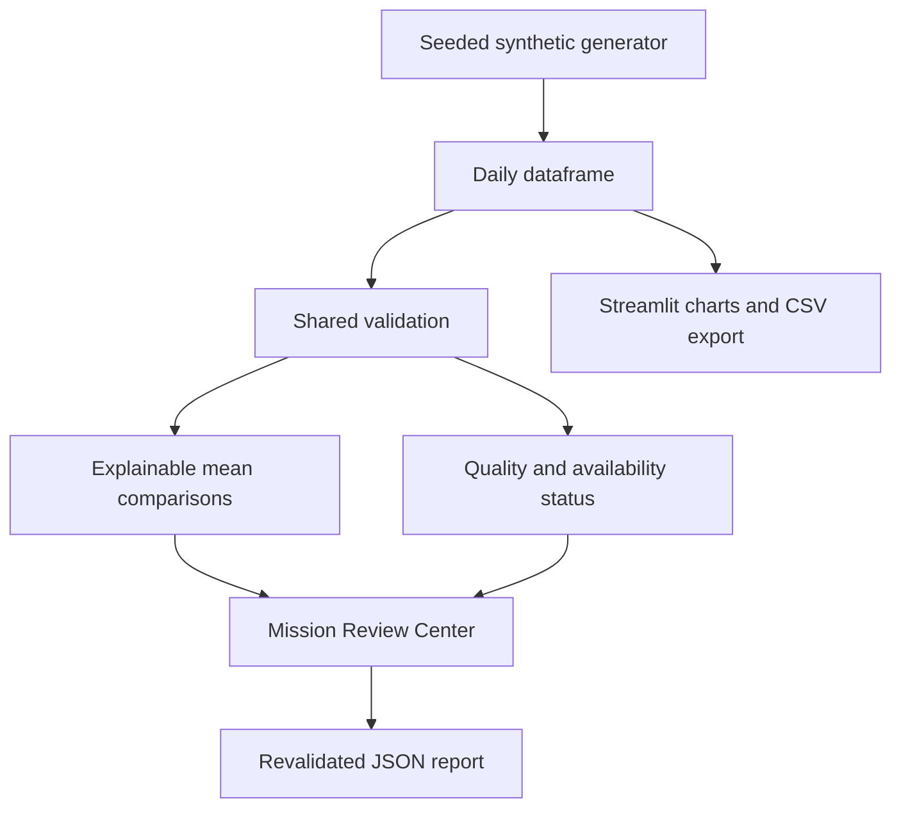

# Architecture — implemented v0.5

ARES is a local Streamlit application using in-memory Pandas dataframes. It generates deterministic fictional daily records; it does not import CSV, connect telemetry, persist reviews in a database, or use machine learning.

- `synthetic.py`: four reproducible scenarios, seed and fictional profile.
- `validation.py`: schema, timestamps, ordering, daily cadence, single nonblank profile, synthetic provenance and measurement sanity checks. Findings block interpretation; inputs are never filled, reordered or changed.
- `analysis.py`: first seven daily observations versus the last four, requiring at least eleven valid consecutive daily observations. Intermediate days in longer series are not included in either mean. Absolute mean differences at or above 12 bpm or 1.5 hours trigger review flags. Activity is visualized and validated but has no change rule.
- `review.py`: deterministic JSON report with input revalidation and recomputed flags. Quality failures take precedence over insufficient data, which takes precedence over change flags. Caller findings can conservatively block a report but cannot override actual input failures. Exported flags are empty whenever interpretation is blocked. Existing schema fields are retained, with additive `application_version` metadata.
- `app.py`: dashboard, Plotly trends, quality warnings, Mission Review Center with review state and a bounded fictional note, CSV and JSON downloads. The selected synthetic data are displayed even when quality blocks interpretation; charts do not establish that analysis is available.

Timestamps are normalized to UTC for validation and explanations. Naive datetime strings are interpreted as UTC; numeric epoch inputs are unsupported. Mixed ISO strings and offset-aware datetimes are supported. Duplicate instants, nonchronological input, and deviations from exactly 24-hour sampling are blocked rather than silently sorted or resampled. This conservative daily-demo contract does not support irregular real-world telemetry.

Measurement bounds are input sanity checks only: resting heart rate `(0, 250]` bpm, sleep `[0, 24]` hours, activity `[0, 1440]` minutes. Numeric strings are accepted; booleans, missing/nonnumeric values, infinity and out-of-range values are blocked. Units are assumed from column names; incorrectly labeled but in-range values cannot be detected automatically.

No external API or credential is required. These rules and tests do not establish clinical validity, medical efficacy, or spaceflight suitability.
