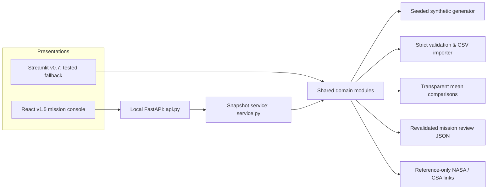

# ARES Health AI Architecture — current main v1.5

## Mission

ARES is an **independent, synthetic, non-clinical prototype** developed for the NASA Space Apps Challenge 2026. It is not NASA-approved medical software. There are currently no live astronaut sensors, wearable streams, authentic medical records, spacecraft operations interfaces, or clinical validations.

## Logical components

**The dependency direction is intentional**: interfaces consume the Python engine, not vice versa. `src/ares_health/service.py` composes existing domain functions into one JSON-safe response. `src/ares_health/api.py` only translates local HTTP requests and responses; it should not contain clinical logic or separate threshold decisions.

## Data flow

1. User selects a **fictional** scenario and deterministic seed, or explicitly attests a small CSV contains only fictional observations.
2. `generate_scenario()` or `load_synthetic_csv()` produces an in-memory dataframe. The CSV importer accepts UTF-8, exactly six fields, explicit UTC, one synthetic SIM profile, strict daily spacing and numeric sanity ranges, max 366 rows, max 1 MB.
3. `quality_issues()` checks required fields, timestamp integrity, daily regularity, provenance, completeness and sanity bounds. Nothing is interpolated, silently reordered or filled.
4. `review_changes()` compares the **first seven daily means** and **last four** using demonstration-only absolute differences: 12 bpm resting heart rate and 1.5 hours sleep. Activity is shown but has **no review rule**.
5. `advanced_stats.describe_signals()` computes optional descriptive medians, MAD and Theil–Sen slope using SciPy for **valid synthetic data only**. These statistics never generate alerts and are omitted for blocked data.
6. `build_review_report()` revalidates at the export boundary; incomplete/invalid observations prevent clinical-sounding interpretations and suppress demo flags. `get_crew_guidance()` provides explanatory verification steps, not medical action or prescriptions.
7. `build_snapshot()` assembles canonical JSON using these functions: missing values as `null`, UTC ISO 8601 strings, and explicit source and limitation labels.
8. The Streamlit app or functional React client presents these results without making up new health readings.

## Security and privacy scope

- Local in-memory processing only. No external storage, credentials, personal/real medical data, NASA telemetry, or databases.
- Uvicorn must listen on `127.0.0.1`. The service does **not** implement authentication and must never be publicly hosted as-is.
- Only `localhost:5173`, `127.0.0.1:5173`, `localhost:3000` and `127.0.0.1:3000` can make cross-origin browser requests through the current CORS policy. This is an origin restriction, not authorization.
- The CSV endpoint enforces a streaming 1,000,000-byte cap and requires `X-Synthetic-Attestation: true`. This header is human attestation, not proof. Do not send real, identifiable or sensitive health information.
- The compiled React v1.5 console is served by FastAPI on loopback port 8000; Streamlit remains an independent fallback.

## Quality assurance

- Python deterministic domain unit tests + Streamlit AppTest; FastAPI TestClient verifies HTTP scenarios, data protection rules, strict JSON, review export and CORS.
- GitHub Actions runs on Python 3.12 and 3.13 for every PR. These are code-level functional tests, not clinical validation.

See `docs/API_CONTRACT.md` for exact HTTP paths, JSON fields and examples. The previously generated Claude HTML and Figma Make previews are **design concepts only** and are not connected to the backend.

## Current integrated architecture and historical milestones

Canonical software version is `APP_VERSION = "1.5"` in `version.py`. FastAPI
serves frontend/dist and the synthetic CSV alongside /api. The current console
includes deterministic offline Copilot, manual four-state review/audit, Wellness
research context and a decorative generated 2D illustration with navigation
overlays; the illustration is not a validated organ model or 3D asset.
Separate opt-in MIT ECG and NASA OSD-87 mouse-study adapters never feed mission
analysis. NASA reads public metadata/small samples on demand; the MIT endpoint
reads a prepared local artifact. No public research availability is assumed.

The versioned notes below record when components were introduced. Earlier
references to a basic UI or excluded anatomy describe those milestones, not
current main. API/schema versions are independent of application version.

## v1.0 mission timeline

`timeline.py` adds a pure, deterministic event projection over synthetic frames.
It delegates whole-frame quality checks and prefix comparisons to the existing
validation/analysis modules, final assessment to the defensive report, and record
formatting to the canonical service serializer. Quality failures suppress all
interpretations; source rows remain unchanged. `GET /api/timeline` generates a
bounded fictional scenario and invokes this projection. No UI, CSV ingestion,
review, persistence or scientific-rule behavior is changed. See `API_CONTRACT.md`
for historical evaluation semantics, event ordering and strict JSON guarantees.

## v1.1 functional React frontend

`frontend/` is a separate Vite/React/TypeScript client of the existing API. Its
modules separate runtime-checked contracts, HTTP adaptation, mission-source state,
raw-value charts, timeline filtering, CSV attestation and review/export controls.
The backend is the sole owner of simulation, validation, thresholds, mean/window
comparisons, descriptive statistics, guidance and report generation. SVG chart
coordinates are presentation transforms only and retain gaps for missing cells.
API findings and references are rendered as text, without HTML injection.

Mission-source changes abort active requests, clear old snapshots/reports and
ignore late results. Blocked analyses expose quality findings without advanced
metrics or reassuring trend statements. CSV analysis uses the accepted snapshot
and embedded report; no timeline HTTP route exists for CSV. No browser storage,
backend persistence or new Python functionality is introduced. This basic UI is
a functional integration milestone; final Figma styling, anatomy and 3D remain
out of scope. CI runs component/adapter tests plus live HTTP checks through Vite.

## v1.2 optional research isolation (integrated on main)

The optional `research.py` domain module and explicit
`scripts.prepare_research_ecg` command own bounded official-file verification,
WFDB parsing, NeuroKit processing and full-resolution beat-reference matching.
Optional pinned tools are in `requirements-research.txt`. `research_api.py` reads
only an already-prepared bounded artifact, behind an opt-in environment flag and
loopback restriction. It performs no network acquisition or detector computation.
Existing synthetic endpoints and mission modules remain unchanged.

React `Workspace` defaults to the existing mission app, preserving its state.
The separate lazy research view requests only the new namespace and labels the
provenance as public terrestrial research, with no upload or clinical inference.
No research result is converted into synthetic observations. These optional modes
are present on main, while source/license and official measured-case verification
remain separate unresolved checks. See `RESEARCH_LAB.md`.

## v1.4 presentation layer

The v1.3 data orchestration remains in App; new console presenters consume its
current snapshot and selected metric. TelemetryCard, BodyViewer and MetricPanel
share selection without computing new physiological findings. ContextDock uses
accessible mounted panels for the existing check-in, CSV, timeline, review, hazard
and evidence components. Research presenters retain separate provenance/state.
Recharts is split into a vendor bundle; the original generated illustration is a
local hashed asset, served by the unchanged FastAPI compiled-asset mount. New
Playwright checks validate real compiled one-server rendering and workflows.

## v1.5 explanatory copilot and audit boundary

`copilot_models.py` defines bounded extra-forbidden source/question/audit contracts;
`copilot.py` rebuilds canonical scenario/check-in/validated CSV contexts and explains
existing output with a conservative intent parser. `copilot_api.py` bounds only
the two new POST routes, sanitizes errors and rejects stale context hashes.
No analysis, research, rule or report module is rewritten. Export copies legacy
report fields and adds recomputed evidence/transcript plus user-declared review.

React's `useMissionCopilot` scopes transient conversation, audit and report state
to the current App mission key/source. `CopilotPanel` and `ReviewWorkflow` share
that session in the existing dock; context replacement cancels requests and resets
state. Four manual workflow states are independent of canonical assessment and
always have `clinical_authorization=false`. There is no server case store, browser
persistence, remote model or physiological calculation in React. See COPILOT_V15.md.
