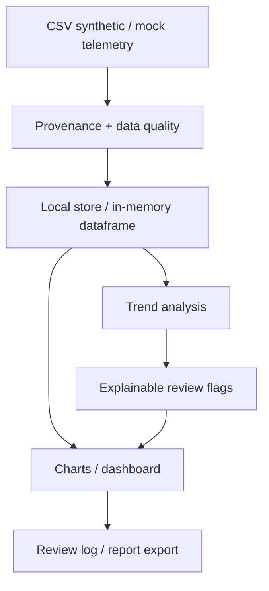

# Architecture plan (to implement during Nov 14–15)



## Component contracts

| Component | Input | Output | Required guardrail |
|---|---|---|---|
| Import | CSV, schema, source metadata | validated observations | reject or flag invalid units/timestamps |
| Storage | valid synthetic observations | local records | no remote upload or personal data |
| Trends | time series | plots and baseline summaries | baseline unavailable = 'insufficient data' |
| Review flags | validated series + documented rules | reason, timestamp, severity for *review* | no diagnostic language |
| Dashboard | processed records | accessible status view | distinguish normal vs missing/unavailable |
| Testing | seeded synthetic scenarios | test report | not a clinical accuracy claim |

## Design rules

- Source records are immutable; keep derived fields separate.
- Timestamp in ISO 8601 UTC; display local time only explicitly.
- Missingness and provenance are first-class fields.
- Alerts carry plain-language explanations and can be dismissed with a logged reason, not erased.
- Keep UI usable without internet; avoid mandatory external API requests.
- Synthetic indicator values and any demonstration thresholds are **illustrative**, not human spaceflight norms.

## Suggested files for implementation

```text
app.py
src/ares_health/ingestion.py
src/ares_health/analysis.py
src/ares_health/alerts.py
src/ares_health/storage.py
src/ares_health/evaluation.py
tests/test_ingestion.py
tests/test_analysis.py
tests/test_alerts.py
```

## Technical tradeoffs

- **Streamlit**: fast local demo; not flight-ready engineering.
- **Pandas/NumPy**: simple transparent processing.
- **Plotly**: local interactive visualization.
- **SQLite**: optional, only if CSV/in-memory is insufficient.
- **AI/ML**: deferred until training data, external evaluation, and failure modes are documented. Rule-based change detection is not ML.
