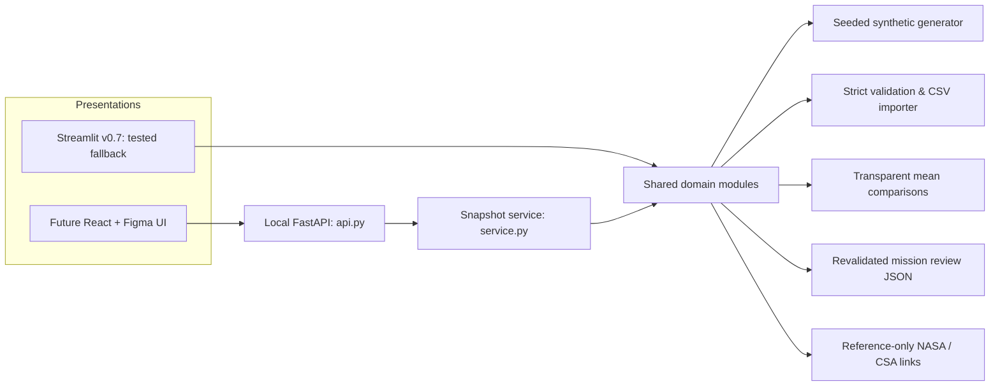

# ARES Health AI Architecture — 0.9 API foundation

## Mission

ARES is an **independent, synthetic, non-clinical prototype** developed for the NASA Space Apps Challenge 2026. It is not NASA-approved medical software. There are currently no live astronaut sensors, wearable streams, authentic medical records, spacecraft operations interfaces, or clinical validations.

## Logical components

**The dependency direction is intentional**: interfaces consume the Python engine, not vice versa. `src/ares_health/service.py` composes existing domain functions into one JSON-safe response. `src/ares_health/api.py` only translates local HTTP requests and responses; it should not contain clinical logic or separate threshold decisions.

## Data flow

1. User selects a **fictional** scenario and deterministic seed, or explicitly attests a small CSV contains only fictional observations.
2. `generate_scenario()` or `load_synthetic_csv()` produces an in-memory dataframe. The CSV importer accepts UTF-8, exactly six fields, explicit UTC, one synthetic SIM profile, strict daily spacing and numeric sanity ranges, max 366 rows, max 1 MB.
3. `quality_issues()` checks required fields, timestamp integrity, daily regularity, provenance, completeness and sanity bounds. Nothing is interpolated, silently reordered or filled.
4. `review_changes()` compares the **first seven daily means** and **last four** using demonstration-only absolute differences: 12 bpm resting heart rate and 1.5 hours sleep. Activity is shown but has **no review rule**.
5. `advanced_stats.describe_signals()` computes optional descriptive medians, MAD and Theil–Sen slope using SciPy for **valid synthetic data only**. These statistics never generate alerts and are omitted for blocked data.
6. `build_review_report()` revalidates at the export boundary; incomplete/invalid observations prevent clinical-sounding interpretations and suppress demo flags. `get_crew_guidance()` provides explanatory verification steps, not medical action or prescriptions.
7. `build_snapshot()` assembles canonical JSON using these functions: missing values as `null`, UTC ISO 8601 strings, and explicit source and limitation labels.
8. The Streamlit app or a future React interface presents these results without making up new health readings.

## Security and privacy scope

- Local in-memory processing only. No external storage, credentials, personal/real medical data, NASA telemetry, or databases.
- Uvicorn must listen on `127.0.0.1`. The service does **not** implement authentication and must never be publicly hosted as-is.
- Only `localhost:5173`, `127.0.0.1:5173`, `localhost:3000` and `127.0.0.1:3000` can make cross-origin browser requests through the current CORS policy. This is an origin restriction, not authorization.
- The CSV endpoint enforces a streaming 1,000,000-byte cap and requires `X-Synthetic-Attestation: true`. This header is human attestation, not proof. Do not send real, identifiable or sensitive health information.
- The full Streamlit v0.7 interface in `main` remains the stable demonstration path until the new interface and API have passed local review.

## Quality assurance

- Python deterministic domain unit tests + Streamlit AppTest; FastAPI TestClient verifies HTTP scenarios, data protection rules, strict JSON, review export and CORS.
- GitHub Actions runs on Python 3.12 and 3.13 for every PR. These are code-level functional tests, not clinical validation.

See `docs/API_CONTRACT.md` for exact HTTP paths, JSON fields and examples. The previously generated Claude HTML and Figma Make previews are **design concepts only** and are not connected to the backend.

## v1.0 mission timeline

`timeline.py` adds a pure, deterministic event projection over synthetic frames.
It delegates whole-frame quality checks and prefix comparisons to the existing
validation/analysis modules, final assessment to the defensive report, and record
formatting to the canonical service serializer. Quality failures suppress all
interpretations; source rows remain unchanged. `GET /api/timeline` generates a
bounded fictional scenario and invokes this projection. No UI, CSV ingestion,
review, persistence or scientific-rule behavior is changed. See `API_CONTRACT.md`
for historical evaluation semantics, event ordering and strict JSON guarantees.
